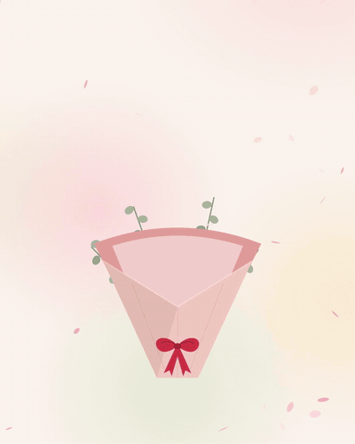
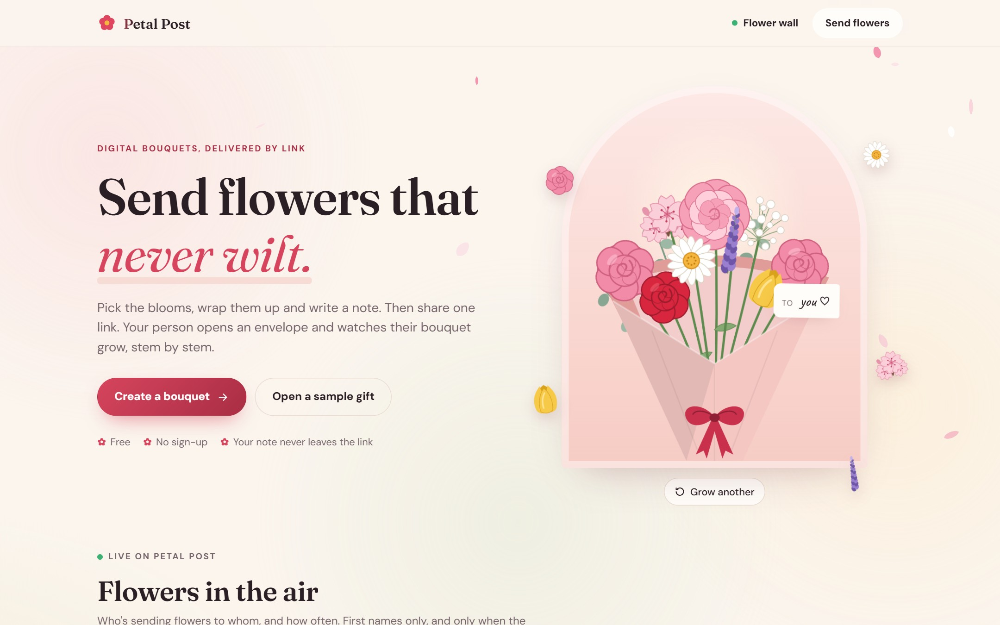
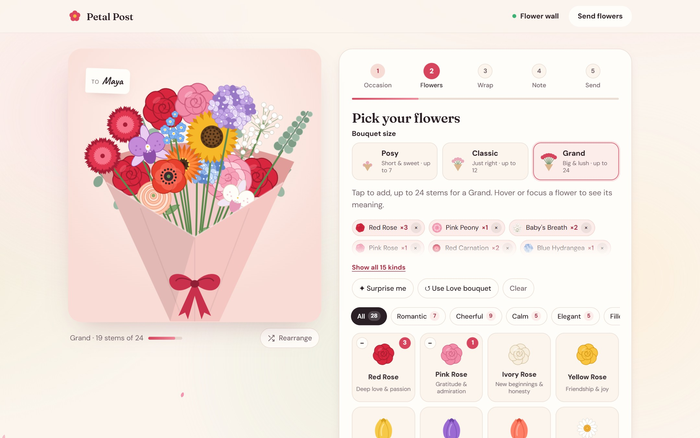
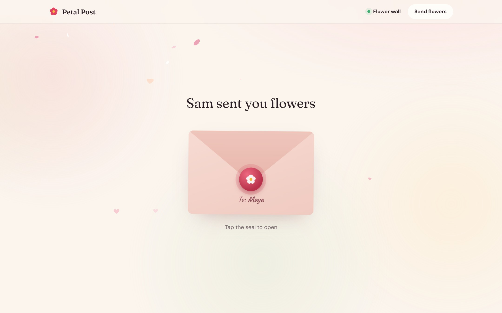
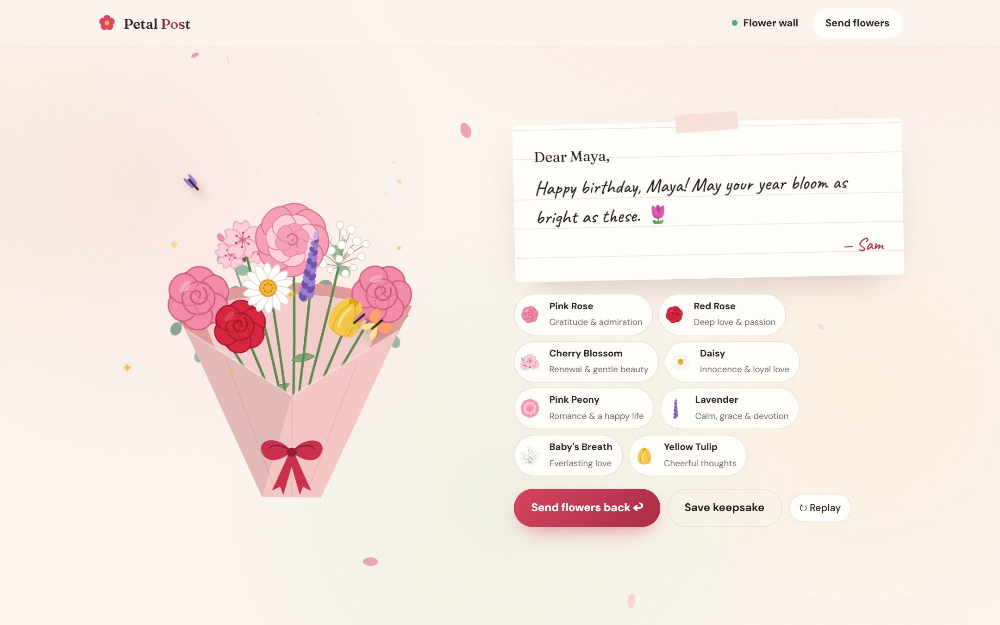
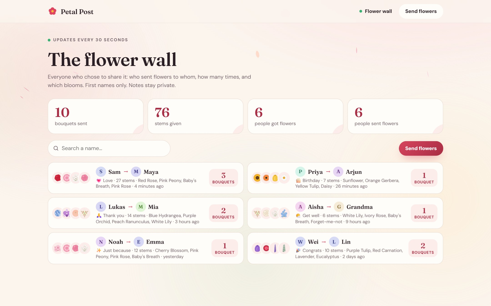
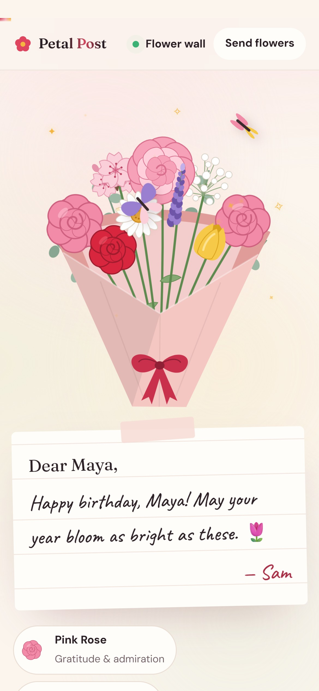

# 💐 Petal Post

Send flowers that never wilt. Build a bouquet, write a note and share one link. Your person opens an envelope and watches it bloom.

**Live:** https://codemitvishal.github.io/petal-post/

  
   
  ▶ <a href="media/petal-post-promo.mp4">Watch the full video with sound</a>

## How it works

1. **Pick an occasion** (love, birthday, thank you, sorry and more) to get a suggested bouquet and note.
2. **Build your bouquet** from 28 flowers, each with its meaning, as a Posy, Classic or Grand.
3. **Wrap it** in your choice of paper and ribbon.
4. **Write your note**, add a photo, and optionally choose the day it opens.
5. **Share one link** on WhatsApp, by email or anywhere else.

Your person sees a sealed envelope with their name on it. They tap the seal, petals burst, the bouquet grows stem by stem and your note writes itself out.

## Screenshots

| Home | Build your bouquet |
| --- | --- |
|  |  |
| **A sealed envelope arrives** | **The gift blooms** |
|  |  |
| **Flower wall** (example data) | **On your phone** |
|  |  |

## Features

- 28 flowers with meanings, filtered by mood
- Posy, Classic or Grand bouquet sizes
- Occasion presets and "Inspire me" notes
- Animated envelope, growing bouquet and handwritten note
- Surprise date with a live countdown
- Photo pinned to the note
- Send flowers back in one tap
- Keepsake image to save
- Optional public flower wall showing who sent flowers to whom

## Privacy

Your note lives only in the link. The wall stores first names and flowers, and only if you opt in.

Made by Vishal Singh.
